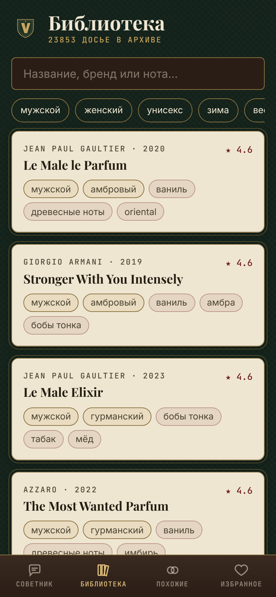
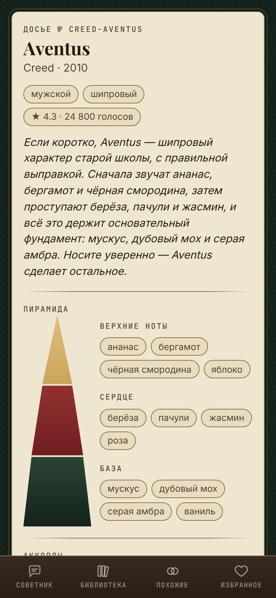
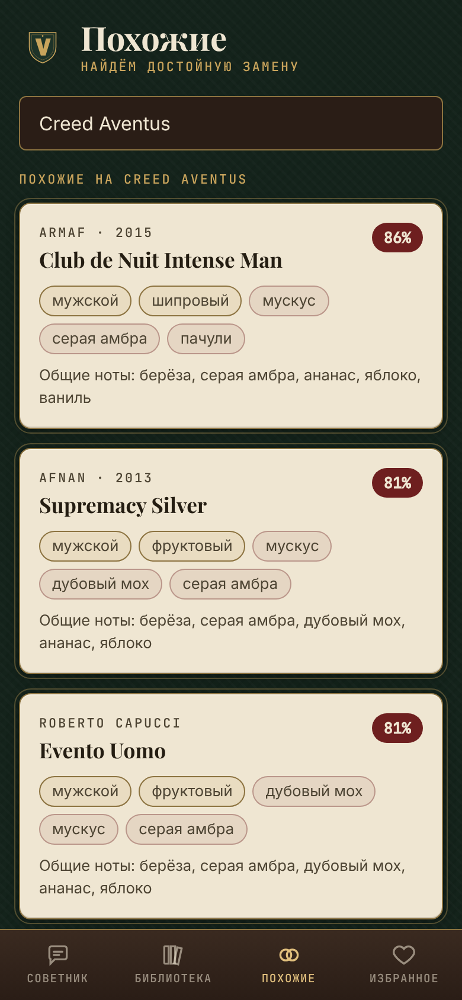
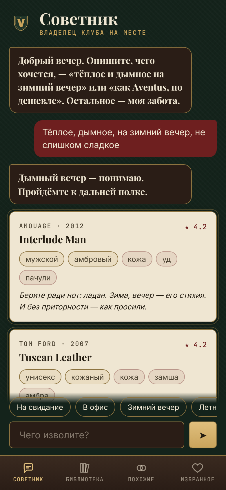

# Veroniks — парфюмерный клуб в Telegram

Карманный парфюмерный советник для себя и друзей: каталог из ~24 000 ароматов с пирамидами нот, поиск похожих, подбор по описанию на русском. Работает как приложение внутри Telegram (Mini App), как обычный сайт, который можно установить на главный экран телефона (PWA), и как бот **@veroniksparfbot**.

**Ключ ИИ не нужен.** Советник работает на собственном движке правил. Если позже появится ключ Anthropic API, советник и описания автоматически переключатся на ИИ.

| Библиотека | Досье аромата | Похожие | Советник |
|---|---|---|---|
|  |  |  |  |

---

## ⚡ Быстрый старт: клуб работает круглосуточно за 5 минут, без установки на компьютер

Ничего скачивать и устанавливать не нужно — всё делается в Telegram и в браузере.

**1. Токен бота (1 минута).** В Telegram откройте **@BotFather** → отправьте `/mybots` → выберите **@veroniksparfbot** → **API Token** → скопируйте строку вида `1234567890:AAH…`. Никому её не пересылайте.

**2. Ваш Telegram ID (30 секунд).** Откройте **@userinfobot**, отправьте любое сообщение — он ответит строкой `Id: 123456789`. Скопируйте число.

**3. Запуск (3 минуты).** Нажмите кнопку:

[](https://render.com/deploy?repo=https://github.com/luosmnazh/veroniksparf)

- Войдите в Render (кнопка **GitHub** или **Google** — это бесплатно, карта не нужна).
- В форме **Blueprint Name** впишите `veroniks`.
- В поле **BOT_TOKEN** вставьте токен из шага 1, в поле **ALLOWED_USER_IDS** — ваш ID из шага 2.
- Нажмите **Deploy Blueprint** и подождите 3–5 минут, пока статус не станет **Live**.

**4. Готово.** Откройте чат с **@veroniksparfbot** и отправьте `/start`. Слева от поля ввода появится кнопка **«Клуб»** — это приложение.

**Добавить друзей:** пусть каждый отправит боту `/id` и пришлёт вам число. В Render: сервис **veroniks** → **Environment** → поле `ALLOWED_USER_IDS` → допишите ID через запятую → **Save Changes**. Сервис перезапустится сам.

> Бесплатный Render «засыпает» после 15 минут тишины: первое сообщение после паузы бот обрабатывает 30–60 секунд, дальше — мгновенно. Адрес приложения и кнопку меню сервер настраивает сам, вписывать `WEBAPP_URL` не нужно.

Всё, что ниже, — для тех, кто хочет запускать проект на своём компьютере, импортировать датасет или менять код.

---

## Оглавление

1. [Что понадобится](#1-что-понадобится)
2. [Скачать проект](#2-скачать-проект)
3. [Установить зависимости](#3-установить-зависимости)
4. [Настроить бота и файл .env](#4-настроить-бота-и-файл-env)
5. [Запустить на своём компьютере](#5-запустить-на-своём-компьютере)
6. [Открыть из Telegram через туннель](#6-открыть-из-telegram-через-туннель-cloudflared)
7. [Зарегистрировать Mini App в @BotFather](#7-зарегистрировать-mini-app-в-botfather-по-желанию)
8. [Каталог ароматов и импорт датасета](#8-каталог-ароматов-и-импорт-датасета)
9. [Постоянный запуск для друзей: Render или Railway](#9-постоянный-запуск-для-друзей)
10. [Подключить ИИ позже](#10-подключить-ии-позже)
11. [Установить на главный экран (PWA)](#11-установить-на-главный-экран-pwa)
12. [Частые проблемы](#12-частые-проблемы)
13. [Для любопытных: как устроен проект](#13-как-устроен-проект)

---

## 1. Что понадобится

- **Компьютер на Windows 10 или 11.**
- **Node.js 22 LTS.** Скачайте с [nodejs.org](https://nodejs.org/) кнопку «LTS», запустите установщик, везде жмите «Далее». Галочку «Automatically install the necessary tools» можно не ставить.
- **Telegram** на телефоне или компьютере.

Проверить, что Node.js установился: нажмите `Win + R`, введите `cmd`, нажмите Enter. В чёрном окне наберите:

```bash
node --version
```

Должно появиться что-то вроде `v22.x.x`.

> **Как открывать командную строку в нужной папке.** Откройте папку проекта в Проводнике, щёлкните по адресной строке сверху, сотрите путь, наберите `cmd` и нажмите Enter. Откроется чёрное окно, уже «стоящее» в этой папке. Все команды ниже вводятся именно так.

## 2. Скачать проект

Самый простой способ — без Git:

1. Откройте страницу репозитория на GitHub.
2. Зелёная кнопка **Code** → **Download ZIP**.
3. Распакуйте архив, например, в `C:\Veroniks`.

Если у вас установлен Git, можно вместо этого:

```bash
git clone https://github.com/luosmnazh/veroniksparf.git C:\Veroniks
```

## 3. Установить зависимости

Откройте командную строку в папке проекта (см. подсказку выше) и выполните:

```bash
npm install
```

Это займёт 1–3 минуты. Предупреждения (`warn`) — нормально; ошибки (`ERR!`) — см. раздел [Частые проблемы](#12-частые-проблемы).

## 4. Настроить бота и файл .env

### 4.1. Токен бота

1. В Telegram откройте **@BotFather**.
2. Отправьте `/mybots` → выберите **@veroniksparfbot** → **API Token**.
3. Скопируйте токен (строка вида `1234567890:AAH...`).

> ⚠️ Токен — это пароль от бота. Не присылайте его никому, в том числе в чаты с ИИ. Если он утёк — в @BotFather: `/mybots` → бот → **API Token** → **Revoke current token**, и впишите новый в `.env`.

### 4.2. Файл .env

В командной строке в папке проекта:

```bash
copy .env.example .env
```

```bash
notepad .env
```

Откроется Блокнот. Заполните:

```ini
BOT_TOKEN=ваш_токен_из_BotFather
WEBAPP_URL=
ALLOWED_USER_IDS=
DATABASE_PATH=data/veroniks.db
ANTHROPIC_API_KEY=
ANTHROPIC_MODEL=
```

- `WEBAPP_URL` пока оставьте пустым — заполним в шаге 6.
- `ALLOWED_USER_IDS` — Telegram ID тех, кому можно пользоваться клубом, через запятую. **Пока пусто — бот открыт всем** (удобно для первой проверки).

Сохраните (`Ctrl + S`) и закройте Блокнот.

Файл `.env` никогда не попадает в Git — это прописано в `.gitignore`.

### 4.3. Как узнать Telegram ID

Запустите проект (шаг 5) и отправьте боту команду `/id` — он ответит числом. Эта команда работает даже для тех, кого ещё нет в списке, поэтому друзья могут сами узнать свой ID и прислать его вам. Потом впишите всех в `.env`:

```ini
ALLOWED_USER_IDS=123456789,987654321
```

и перезапустите проект. Посторонние получат вежливый отказ в стиле клуба.

## 5. Запустить на своём компьютере

```bash
npm run dev
```

Одна команда запускает всё сразу: сервер, веб-приложение и бота (бот — только если в `.env` есть `BOT_TOKEN`).

- Откройте в браузере **http://localhost:5173** — это приложение.
- Напишите боту в Telegram `/start` — он должен ответить.

Остановить — `Ctrl + C` в окне командной строки.

> Витрина дизайна (все цвета, кнопки и элементы): http://localhost:5173/styleguide

## 6. Открыть из Telegram через туннель (cloudflared)

Telegram открывает Mini App только по адресу **https://**, а ваш компьютер доступен лишь как `localhost`. Туннель cloudflared даёт временный публичный https-адрес бесплатно и без регистрации.

### 6.1. Установка (один раз)

В командной строке:

```bash
winget install --id Cloudflare.cloudflared
```

Закройте и заново откройте командную строку, проверьте:

```bash
cloudflared --version
```

Если `winget` не найден — скачайте `cloudflared-windows-amd64.exe` со [страницы релизов](https://github.com/cloudflare/cloudflared/releases/latest), переименуйте в `cloudflared.exe` и положите в папку проекта.

### 6.2. Запуск

1. В **первом** окне командной строки запустите проект: `npm run dev`.
2. Откройте **второе** окно командной строки и выполните:

   ```bash
   cloudflared tunnel --url http://localhost:5173
   ```

3. Через несколько секунд в выводе появится рамка с адресом вида
   `https://какие-то-слова.trycloudflare.com` — скопируйте его.
4. Впишите адрес в `.env`:

   ```ini
   WEBAPP_URL=https://какие-то-слова.trycloudflare.com
   ```

5. В первом окне остановите проект (`Ctrl + C`) и запустите снова `npm run dev`.

При старте сервер **сам** настроит кнопку меню бота на этот адрес — в логе появится строка `Кнопка меню бота → https://…`. Откройте чат с ботом: слева от поля ввода появится кнопка **«Клуб»**, а в ответе на `/start` — кнопка **«Войти в клуб»**.

> Бесплатный адрес trycloudflare меняется при каждом перезапуске cloudflared. Тогда повторите пункты 3–5. Для постоянного адреса — разверните проект на хостинге (шаг 9).

## 7. Зарегистрировать Mini App в @BotFather (по желанию)

Кнопка меню уже работает и без этого шага. Регистрация Mini App даёт красивую ссылку `t.me/veroniksparfbot/club` и прямые ссылки на карточки ароматов.

1. В @BotFather отправьте `/newapp`.
2. Выберите **@veroniksparfbot**.
3. **Title:** `Veroniks`.
4. **Description:** `Парфюмерный клуб: каталог, похожие ароматы и советник`.
5. **Photo:** картинка 640×360 (можно скриншот приложения).
6. **GIF:** отправьте `/empty`.
7. **Web App URL:** ваш `WEBAPP_URL` (адрес туннеля или хостинга).
8. **Short name:** например `club`.

Готово: приложение открывается по ссылке `https://t.me/veroniksparfbot/club`.

Ссылка сразу на карточку аромата: `https://t.me/veroniksparfbot/club?startapp=p_creed-aventus` — после `p_` идёт идентификатор аромата (его видно в адресе карточки: `/p/creed-aventus`).

> При смене адреса туннеля обновите URL: `/myapps` → приложение → **Edit Web App URL**.

## 8. Каталог ароматов и импорт датасета

**Каталог уже собран.** В клубе около 24 000 ароматов: 69 встроенных с выверенными вручную пирамидами и ~23 800 из датасета Fragrantica. Он лежит в файле `data/catalog.json.gz` (2 МБ) и загружается сервером при каждом запуске — поэтому работает и на бесплатном Render без постоянного диска. Ничего делать не нужно.

Что происходит с данными при сборке:

- названия вида `club-de-nuit-intense-man` превращаются в «Club de Nuit Intense Man»;
- ноты нормализуются: опечатки датасета исправляются (`sandalowood` → сандал), происхождение сырья отбрасывается («Indian oud» → уд), ~97 % упоминаний нот переведены на русский, редкие показываются в оригинале;
- семейство определяется по главному аккорду, сезоны и поводы — по аккордам;
- описания собираются шаблонами при запуске сервера;
- у встроенных ароматов остаются их пирамиды, а рейтинг, число голосов и ссылка берутся из датасета;
- ароматы, за которые проголосовали меньше 10 человек, отбрасываются.

Сортировка «по рейтингу» и советник используют **взвешенный рейтинг**: оценка от 30 человек тянется к средней по каталогу, а оценка от 20 000 — почти нет. Поэтому классика не тонет среди малоизвестных ароматов с одной-двумя восторженными оценками.

### Пересобрать каталог из другого датасета

1. Положите файл(ы) `.csv` или `.xlsx` с колонками нот в папку `data\raw`.
2. Посмотрите, как скрипт понял структуру:

   ```bash
   npm run import-csv -- --dry
   ```

   Скрипт покажет кодировку, разделитель, колонки, найденный маппинг и первые строки.

3. Соберите каталог:

   ```bash
   npm run build-catalog
   ```

   Скрипт сообщит, сколько ароматов собрано, какие встроенные ароматы нашлись в датасете и какие ноты чаще всего остались без перевода — их можно дописать в `shared/src/notes-ru.ts`.

4. Перезапустите проект. Сервер заметит, что файл каталога изменился, и пересоберёт базу (ИИ-описания, если вы их делали, сохранятся).

Если имена колонок в вашем файле другие — добавьте их в список `COLUMN_ALIASES` в файле `scripts/src/import-lib.ts`. Флаг `--min-votes 50` оставит только ароматы, за которые проголосовали хотя бы 50 человек.

Файл **без нот** (как `fragrantica_all.xlsx`: бренд, название, год, ссылка) для каталога не подходит — ароматы без пирамид нельзя сравнивать и советовать. Его можно использовать только для дополнения ссылок: `npm run import-csv`.

### Источник данных

Каталог собран из датасета [Fragrantica.com Fragrance Dataset](https://www.kaggle.com/datasets/olgagmiufana1/fragrantica-com-fragrance-dataset) (Kaggle, файл `fra_cleaned.csv`). По имеющимся сведениям, он распространяется по лицензии [CC BY-NC-SA 4.0](https://creativecommons.org/licenses/by-nc-sa/4.0/) — некоммерческое использование с указанием источника; **проверьте лицензию на странице датасета**, при сборке каталога её не удалось сверить. Veroniks — некоммерческий проект для себя и друзей. Сайт Fragrantica проект не парсит.

## 9. Постоянный запуск для друзей

Пока работает туннель, клуб доступен, только когда включён ваш компьютер. Чтобы он работал круглосуточно, разверните его на хостинге. В проекте есть `Dockerfile` — хостинг соберёт всё сам. Бот там работает в режиме webhook.

**Важно про базу.** Избранное и гардероб хранятся у пользователей (в облаке Telegram или в браузере), а не на сервере. Поэтому даже если база на сервере пересоздаётся при перезапуске, никто ничего не теряет — каталог восстанавливается из встроенного набора. Постоянный диск нужен, только если вы импортировали большую базу на сервере или генерировали ИИ-описания.

### Вариант А: Render (есть бесплатный план)

Самый короткий путь — кнопка **Deploy to Render** из раздела [«Быстрый старт»](#-быстрый-старт-клуб-работает-круглосуточно-за-5-минут-без-установки-на-компьютер) в начале. Вручную:

1. Зарегистрируйтесь на [render.com](https://render.com) через GitHub или Google.
2. **New** → **Blueprint** → вставьте адрес репозитория `https://github.com/luosmnazh/veroniksparf`. Render прочитает файл `render.yaml`.
3. Render спросит значения переменных: `BOT_TOKEN` — токен бота; `ALLOWED_USER_IDS` — ID через запятую.
4. Нажмите **Deploy Blueprint**. Сборка займёт 3–5 минут.
5. Остановите локальный `npm run dev`, если он запущен: один и тот же бот не может одновременно работать и с компьютера, и с хостинга.
6. Если регистрировали Mini App (шаг 7) — обновите его URL в @BotFather на адрес сервиса (вверху страницы сервиса в Render, вида `https://veroniks-xxxx.onrender.com`).

`WEBAPP_URL` на Render вписывать не нужно: сервер берёт свой адрес из переменной `RENDER_EXTERNAL_URL`, которую Render задаёт сам. Сервер при старте сам подключит webhook и кнопку меню.

> На бесплатном плане Render «засыпает» после 15 минут без запросов. Первое сообщение после паузы бот обработает с задержкой 30–60 секунд, дальше — мгновенно. Постоянный диск на Render доступен на платном плане Starter — в `render.yaml` есть закомментированный блок `disk`.

### Вариант Б: Railway (около 5 $ в месяц, не засыпает)

1. Зарегистрируйтесь на [railway.com](https://railway.com) через GitHub.
2. **New Project** → **Deploy from GitHub repo** → `veroniksparf`. Railway найдёт `Dockerfile`.
3. **Variables** → добавьте `BOT_TOKEN` и `ALLOWED_USER_IDS`.
4. **Settings** → **Networking** → **Generate Domain** — сервер сам возьмёт этот адрес из `RAILWAY_PUBLIC_DOMAIN`, вписывать `WEBAPP_URL` не нужно.
5. По желанию: **правый клик по сервису → Attach Volume**, путь монтирования `/data` — база будет переживать перезапуски.

## 10. Подключить ИИ позже

Когда появится ключ Anthropic API ([console.anthropic.com](https://console.anthropic.com)):

1. Впишите его в `.env` на компьютере (или в переменные окружения на хостинге):

   ```ini
   ANTHROPIC_API_KEY=ваш_ключ
   ```

2. Перезапустите проект. В логе появится `Советник: ИИ-режим (…)`.

Что изменится:

- **Советник** начнёт понимать свободные, сложные фразы. Он по-прежнему выбирает только из ароматов вашей базы: движок правил отбирает 25 кандидатов, ИИ выбирает из них лучших и пишет объяснения. Запросы вида «как Aventus» по-прежнему решает бесплатный алгоритм похожести.
- Если ИИ недоступен (нет сети, закончились деньги, ошибка) — советник тихо вернётся к движку правил. Пустых экранов не будет.
- **Описания** можно переписать ИИ-текстами:

  ```bash
  npm run describe-ai -- --limit 20
  ```

  Скрипт обрабатывает только ароматы, которые ещё не переписаны, и сохраняет результат в базе — повторный запуск не тратит деньги на уже готовое. Флаг `--force` переписывает всё заново.

Модель по умолчанию — `claude-opus-5-5`. Для экономии можно указать другую, например `ANTHROPIC_MODEL=claude-haiku-5-5`.

## 11. Установить на главный экран (PWA)

- **Из Telegram:** вкладка «Избранное» → внизу «Открыть в браузере» → затем в браузере:
  - **iPhone (Safari):** «Поделиться» → «На экран “Домой”».
  - **Android (Chrome):** меню ⋮ → «Добавить на главный экран».
- Ссылка «Открыть в браузере» содержит ваш личный ключ доступа, поэтому установленное приложение работает и в закрытом режиме. Не пересылайте эту ссылку посторонним.
- Каталог, просмотренные карточки и избранное доступны **без интернета**.

## 12. Частые проблемы

| Что случилось | Что делать |
|---|---|
| `'npm' не является внутренней или внешней командой` | Не установлен Node.js или нужно перезапустить командную строку после установки. |
| При `npm install` ошибка про `better-sqlite3` / `node-gyp` | Убедитесь, что стоит Node.js **22 LTS** (не «Current»). Удалите папку `node_modules` и повторите `npm install`. |
| Бот молчит | Проверьте `BOT_TOKEN` в `.env`. Убедитесь, что бот не запущен одновременно на хостинге (тогда он работает в режиме webhook и не получает сообщения на компьютере). |
| Бот отвечает «клуб закрытый» вам самим | Ваш ID не в `ALLOWED_USER_IDS`. Узнайте его командой `/id`, впишите, перезапустите. |
| Нет кнопки «Клуб» / «Войти в клуб» | `WEBAPP_URL` пустой или не начинается с `https://`. Заполните (шаг 6) и перезапустите. |
| Mini App показывает «Blocked request» или не грузится | Адрес туннеля сменился — обновите `WEBAPP_URL` и перезапустите. |
| Порт занят (`EADDRINUSE`) | Проект уже запущен в другом окне. Закройте его или перезагрузите компьютер. |
| В приложении «Клуб закрыт» при открытии в браузере | В закрытом режиме браузер должен получить ключ — откройте ссылку из вкладки «Избранное» внутри Telegram. |

## 13. Как устроен проект

```
veroniksparf/
├── prd.md              — документ требований
├── shared/             — общая логика (используется и сервером, и сайтом)
│   └── src/
│       ├── seed/       — встроенные ароматы с пирамидами
│       ├── notes-ru.ts — перевод ~300 нот на русский
│       ├── normalize.ts— нормализация и синонимы нот
│       ├── similarity.ts — алгоритм «похожих»
│       ├── describe.ts — шаблонные описания в стиле клуба
│       └── advisor/    — советник: словарь фраз, разбор запроса, подбор
├── server/             — сервер (Fastify + SQLite) и Telegram-бот (grammY)
├── web/                — веб-приложение (React + Vite + PWA)
├── scripts/            — импорт датасета, ИИ-описания, генерация иконок
├── data/raw/           — сюда кладутся CSV/XLSX для импорта
├── Dockerfile          — сборка для хостинга
└── render.yaml         — настройки для Render
```

**Похожие ароматы.** Взвешенный коэффициент Жаккара по нотам (база ×2, сердце ×1.5, верх ×1) — 55 %, косинусная близость аккордов — 35 %, совпадение семейства — 10 %. Кандидаты отбираются через индекс по нотам, поэтому поиск быстрый и на десятках тысяч ароматов. Общие ноты показываются по «редкости»: берёза и ананас информативнее мускуса и ванили.

**Советник без ИИ.** Словарь из 280+ русских выражений («дымный», «как после дождя», «кожаный», «для офиса», «мужу»…) превращает запрос в ноты, аккорды, сезон, повод и пол. Понимает отрицания («не слишком сладкое», «без уда») и упоминания ароматов («как Aventus, но дешевле»). Ароматы оцениваются по совпадениям с поправкой на рейтинг, а объяснения собираются из шаблонов фраз в стиле владельца клуба.

**Безопасность.** Каждый запрос к API из Mini App подписан Telegram (`initData`) — сервер проверяет подпись токеном бота. Белый список `ALLOWED_USER_IDS` действует и в боте, и в API. Есть ограничение частоты запросов. Секреты хранятся только в `.env` и не пишутся в логи.

### Команды

| Команда | Что делает |
|---|---|
| `npm run dev` | разработка: сервер + сайт + бот (long polling) |
| `npm test` | все тесты (похожесть, нормализация, импорт, советник, бот, безопасность) |
| `npm run build` | собрать сайт для продакшна |
| `npm start` | запустить собранную версию (как на хостинге) |
| `npm run build-catalog` | собрать каталог `data/catalog.json.gz` из датасета в `data/raw` |
| `npm run import-csv` | посмотреть структуру датасета (`-- --dry`) или дополнить ссылки |
| `npm run describe-ai` | переписать описания через ИИ (нужен ключ) |
| `npm run gen-icons` | пересобрать иконки PWA из `web/public/logo.svg` |
